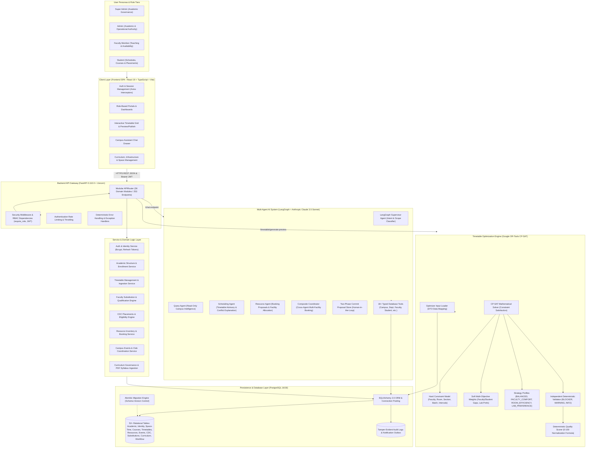
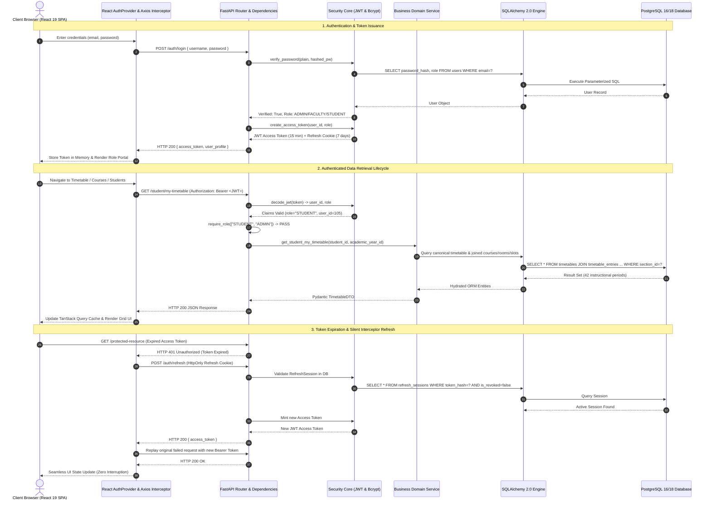
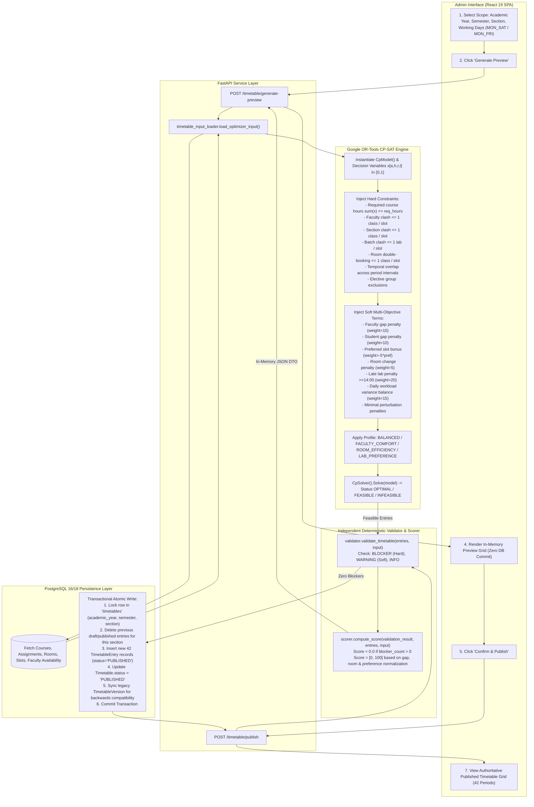

# RIO-MJP: Architecture Diagrams Repository

This directory contains the authoritative Mermaid architecture diagrams representing the actual technical implementation of RIO-MJP (REVA Intelligent Operations — Multi-Agent Journey Platform).

---

## 1. Overall System Architecture
File: [`01_overall_system_architecture.mmd`](./01_overall_system_architecture.mmd)



---

## 2. Frontend-Backend-Database Architecture
File: [`02_frontend_backend_database_architecture.mmd`](./02_frontend_backend_database_architecture.mmd)



---

## 3. Agentic Workflow Architecture (LangGraph)
File: [`03_agentic_workflow_architecture.mmd`](./03_agentic_workflow_architecture.mmd)

```mermaid
graph TD
    subgraph Client ["Client Interface"]
        USER["Authenticated User (Admin / Faculty / Student)"]
        DRAWER["Campus Assistant Drawer (React 19)"]
    end

    subgraph API_Route ["FastAPI Backend Layer"]
        CHAT_ENDPOINT["POST /chat Endpoint"]
        AUTH_INSPECT["Extract User Role & Department Claims"]
    end

    subgraph LangGraph_Runtime ["LangGraph Supervisor Engine"]
        INIT_STATE["Initialize AgentState (user_id, role, dept, message)"]
        SUPERVISOR["Supervisor Node (Intent Classifier & Authorization Guard)"]
        ROUTER{"Conditional Edge: route_supervisor()"}

        subgraph SpecialistAgents ["Specialist Agent Nodes"]
            QUERY_NODE["Query Agent Node (Campus Intelligence)"]
            SCHED_NODE["Scheduling Agent Node (Timetable Advisory)"]
            RES_NODE["Resource Agent Node (Facility Bookings)"]
            COMP_NODE["Composite Coordinator Node (Cross-Agent Orchestration)"]
        end

        END_NODE["End Node (Consolidate State & Sanitize Plain English)"]
    end

    subgraph GroundingLayer ["Deterministic Grounding & Tools Layer"]
        TOOL_REGISTRY["Typed Database Tool Registry"]
        CAMPUS_TOOLS["Campus & Infrastructure Tools"]
        ACAD_TOOLS["Academic Roster & Student Profile Tools"]
        TIMETABLE_TOOLS["Timetable & Conflict Checking Tools"]
        BOOKING_TOOLS["Resource Availability & Reservation Tools"]
    end

    subgraph ExternalLLM ["LLM Dual-Engine Execution"]
        API_CHECK{"ANTHROPIC_API_KEY Configured?"}
        CLAUDE["Anthropic Claude 3.5 Sonnet (Tool Calling API)"]
        DETERMINISTIC_FALLBACK["Deterministic Pattern-Matching Tool Dispatcher"]
    end

    subgraph HumanInTheLoop ["Human-in-the-Loop Governance"]
        PROP_STORE["Two-Phase Proposal Store (op_prop_*, res_prop_*)"]
        CONFIRM_CHECK{"User Confirmed Action Token?"}
        MUTATION["Execute Authorized Mutation Transaction"]
        PROPOSAL_RESPONSE["Return Proposal Summary & Confirmation Token"]
    end

    subgraph Database ["PostgreSQL Database (Source of Truth)"]
        PG_DB[("PostgreSQL 16/18 Tables (Zero Hallucination Grounding)")]
    end

    USER -->|Type Natural Language Query| DRAWER
    DRAWER -->|POST /chat { message }| CHAT_ENDPOINT
    CHAT_ENDPOINT --> AUTH_INSPECT
    AUTH_INSPECT --> INIT_STATE
    INIT_STATE --> SUPERVISOR
    SUPERVISOR --> ROUTER

    ROUTER -->|Read-only info| QUERY_NODE
    ROUTER -->|Timetable/Solver inquiry| SCHED_NODE
    ROUTER -->|Facility reservation| RES_NODE
    ROUTER -->|Room + Faculty supervision| COMP_NODE
    ROUTER -->|Out-of-scope / Refusal| END_NODE

    QUERY_NODE --> API_CHECK
    API_CHECK -->|Yes| CLAUDE
    API_CHECK -->|No / Offline| DETERMINISTIC_FALLBACK

    CLAUDE --> TOOL_REGISTRY
    DETERMINISTIC_FALLBACK --> TOOL_REGISTRY

    TOOL_REGISTRY --> CAMPUS_TOOLS
    TOOL_REGISTRY --> ACAD_TOOLS
    TOOL_REGISTRY --> TIMETABLE_TOOLS
    TOOL_REGISTRY --> BOOKING_TOOLS

    CAMPUS_TOOLS --> PG_DB
    ACAD_TOOLS --> PG_DB
    TIMETABLE_TOOLS --> PG_DB
    BOOKING_TOOLS --> PG_DB

    RES_NODE --> CONFIRM_CHECK
    SCHED_NODE --> CONFIRM_CHECK
    CONFIRM_CHECK -->|No: Generate Proposal| PROP_STORE
    PROP_STORE --> PROPOSAL_RESPONSE
    CONFIRM_CHECK -->|Yes: Token Valid & Role Authorized| MUTATION
    MUTATION --> PG_DB

    QUERY_NODE --> END_NODE
    SCHED_NODE --> END_NODE
    RES_NODE --> END_NODE
    COMP_NODE --> END_NODE

    END_NODE -->|Sanitized Plain English Reply + Sources| CHAT_ENDPOINT
    CHAT_ENDPOINT -->|HTTP 200 JSON Response| DRAWER
    DRAWER -->|Display Assistant Message| USER
```

---

## 4. Timetable Generation Workflow (Google OR-Tools CP-SAT)
File: [`04_timetable_generation_workflow.mmd`](./04_timetable_generation_workflow.mmd)



---

## 5. Authentication & Authorization Workflow
File: [`05_authentication_workflow.mmd`](./05_authentication_workflow.mmd)

```mermaid
sequenceDiagram
    autonumber
    actor Client as User / Browser
    participant Gateway as FastAPI Router (/auth/login)
    participant RateLimiter as Rate Limiting Middleware
    participant AuthCore as Auth Service & Passlib Bcrypt
    participant DB as PostgreSQL Database
    participant JWT as PyJWT Token Engine

    Note over Client, JWT: Phase 1: Authentication & Credential Verification
    Client->>Gateway: POST /auth/login { username: "admin@campus.edu", password: "Password@123" }
    Gateway->>RateLimiter: check_rate_limit(client_ip, email)
    alt Rate Limit Exceeded (> 5 attempts / min)
        RateLimiter-->>Client: HTTP 429 Too Many Requests { retry_after: 60 }
    else Rate Limit OK
        RateLimiter->>AuthCore: authenticate_user(email, password)
        AuthCore->>DB: SELECT id, email, password_hash, role, is_active FROM users WHERE email=?
        DB-->>AuthCore: User Record
        AuthCore->>AuthCore: pwd_context.verify(password, password_hash)
        alt Invalid Password / Inactive User
            AuthCore-->>Client: HTTP 401 Unauthorized "Invalid email or password"
        else Credentials Valid
            AuthCore->>JWT: create_access_token(sub=user.id, role=user.role, exp=15m)
            JWT-->>AuthCore: access_token (HS256 signed JWT)
            AuthCore->>JWT: create_refresh_token(sub=user.id, exp=7d)
            JWT-->>AuthCore: refresh_token_string
            AuthCore->>DB: INSERT INTO refresh_sessions (user_id, token_hash, expires_at) VALUES (...)
            DB-->>AuthCore: Session Saved
            AuthCore-->>Gateway: AuthResult { access_token, user_profile, refresh_token }
            Gateway-->>Client: HTTP 200 OK (Set-Cookie: refresh_token; HttpOnly; SameSite=Lax)<br/>Body: { access_token, token_type: "bearer", user: {...} }
        end
    end

    Note over Client, JWT: Phase 2: Role-Based Authorization on Protected Route
    Client->>Gateway: GET /admin/academic/departments (Header: "Authorization: Bearer <access_token>")
    Gateway->>JWT: decode_token(access_token, SECRET_KEY, algorithms=["HS256"])
    alt Token Invalid / Expired
        JWT-->>Client: HTTP 401 Unauthorized "Could not validate credentials"
    else Token Valid
        JWT-->>Gateway: Payload { sub: 1, role: "ADMIN", exp: 1718000000 }
        Gateway->>Gateway: require_role(["ADMIN", "SUPER_ADMIN"])
        alt Insufficient Permissions
            Gateway-->>Client: HTTP 403 Forbidden "Operation not permitted for role STUDENT"
        else Authorized
            Gateway->>DB: Execute Business Query (SELECT * FROM departments)
            DB-->>Gateway: Department Records
            Gateway-->>Client: HTTP 200 OK [ { id: 1, name: "AI & DS", code: "AIDS" }, ... ]
        end
    end
```

---

## 6. Relational Database ER Diagram (52+ Tables)
File: [`06_database_er_diagram.mmd`](./06_database_er_diagram.mmd)

```mermaid
erDiagram
    users ||--o{ students : "is profile of"
    users ||--o{ faculty : "is profile of"
    users ||--o{ refresh_sessions : "has active sessions"
    users ||--o{ audit_logs : "triggers"
    users ||--o{ notifications : "receives"
    users ||--o{ resource_bookings : "requests"
    users ||--o{ chat_conversations : "owns"

    departments ||--o{ programs : "offers"
    departments ||--o{ faculty : "employs"
    departments ||--o{ courses : "administers"
    departments ||--o{ rooms : "owns/allocated"
    programs ||--o{ semesters : "contains"
    semesters ||--o{ sections : "subdivides into"
    sections ||--o{ batches : "divides into lab cohorts"
    sections ||--o{ students : "enrolls"
    sections ||--o{ timetables : "has canonical schedule"
    academic_years ||--o{ semesters : "spans"
    academic_years ||--o{ timetables : "academic scope"

    courses ||--o{ course_assignments : "assigned to"
    faculty ||--o{ course_assignments : "teaches"
    sections ||--o{ course_assignments : "allocated for"
    batches ||--o{ course_assignments : "allocated for lab"
    elective_groups ||--o{ elective_group_courses : "contains"
    courses ||--o{ elective_group_courses : "mapped in"

    buildings ||--o{ rooms : "houses"
    rooms ||--o{ labs : "specialized as"
    rooms ||--o{ timetable_entries : "hosts class"
    time_slots ||--o{ timetable_entries : "scheduled at"
    faculty ||--o{ faculty_availability : "defines preferences"
    time_slots ||--o{ faculty_availability : "applies to"

    timetables ||--o{ timetable_entries : "contains classes"
    courses ||--o{ timetable_entries : "instructed subject"
    faculty ||--o{ timetable_entries : "assigned teacher"
    sections ||--o{ timetable_entries : "attending section"
    batches ||--o{ timetable_entries : "attending batch"

    resources ||--o{ resource_bookings : "booked in"
    rooms ||--o{ resource_bookings : "allocated venue"

    clubs ||--o{ campus_events : "organizes"
    placement_drives ||--o{ placement_schedules : "schedules rounds"
    students ||--o{ student_academic_records : "academic history"

    faculty ||--o{ faculty_substitutions : "absent faculty"
    faculty ||--o{ faculty_substitutions : "substitute faculty"
    timetable_entries ||--o{ faculty_substitutions : "covered lecture"

    regulations ||--o{ curriculum_versions : "governs"
    curriculum_versions ||--o{ curriculum_semesters : "structures"
    curriculum_versions ||--o{ curriculum_releases : "version snapshots"
    admission_cohorts ||--o{ students : "admission cohort"

    users {
        int id PK
        string email UK
        string password_hash
        string role "SUPER_ADMIN | ADMIN | FACULTY | STUDENT"
        boolean is_active
    }

    students {
        int id PK
        int user_id FK
        string srn UK
        int department_id FK
        int section_id FK
        int batch_id FK
    }

    faculty {
        int id PK
        int user_id FK
        string employee_id UK
        string designation
        int department_id FK
        string specialization
    }

    timetables {
        int id PK
        int academic_year_id FK
        int semester_id FK
        int section_id FK
        string status "DRAFT | PUBLISHED | ARCHIVED"
        string working_days "MON_SAT | MON_FRI"
    }

    timetable_entries {
        int id PK
        int timetable_id FK
        int course_id FK
        int faculty_id FK
        int room_id FK
        int slot_id FK
        int section_id FK
        int batch_id FK
        string hour_type "THEORY | PRACTICAL | TUTORIAL"
        string status "ACTIVE | CANCELLED | RESCHEDULED"
    }

    rooms {
        int id PK
        int building_id FK
        string room_number
        int floor_number
        int capacity
        string room_type "CLASSROOM | LAB | SEMINAR_HALL"
    }

    time_slots {
        int id PK
        string day "MON .. SAT"
        time start_time
        time end_time
        string slot_type "REGULAR | BREAK | LUNCH"
    }
```



---

## 7. Data Flow Diagram (DFD Level 0 & Level 1)
File: [`07_data_flow_diagram.mmd`](./07_data_flow_diagram.mmd)

```mermaid
flowchart TD
    USER_STUDENT(["Student Persona"])
    USER_FACULTY(["Faculty Persona"])
    USER_ADMIN(["Admin / Super Admin Persona"])

    subgraph P1 ["Process 1: Authentication & RBAC Engine"]
        AUTH_LOGIN["1.1 Verify Credentials (Bcrypt)"]
        AUTH_JWT["1.2 Generate Access Token & Refresh Cookie"]
        AUTH_GUARD["1.3 RBAC Route Guard & Permission Inspector"]
    end

    subgraph P2 ["Process 2: Constraint Optimization Engine"]
        LOAD_INPUT["2.1 Aggregate Input Constraints (DTO)"]
        SOLVE_CPSAT["2.2 CP-SAT Constraint Programming Solver"]
        VALIDATE_SCORE["2.3 Independent Validation & Quality Scoring"]
        CANONICAL_PUB["2.4 Transactional Publication & Archival"]
    end

    subgraph P3 ["Process 3: Multi-Agent Natural Language Assistant"]
        INTENT_CLASSIFY["3.1 Intent & Entity Extraction (Supervisor)"]
        AGENT_DISPATCH["3.2 Route to Specialist Agent (Query/Sched/Res)"]
        GROUNDING_EXEC["3.3 Grounded Tool Execution (Zero Hallucination)"]
        PROPOSAL_MGMT["3.4 Two-Phase Human Approval Handling"]
    end

    subgraph P4 ["Process 4: Resource & Event Allocation Engine"]
        AVAIL_CHECK["4.1 Temporal Overlap & Capacity Conflict Detection"]
        FACULTY_SUB["4.2 Faculty Substitution Qualification Engine"]
        CDC_ELIG["4.3 CDC Placement Eligibility & Registration Engine"]
    end

    subgraph DataStores ["Relational Data Stores (PostgreSQL)"]
        DS_AUTH[("D1: Users, Roles & Refresh Sessions")]
        DS_ACAD[("D2: Academic Hierarchy (Depts, Progs, Sections, Batches)")]
        DS_SPACE[("D3: Campus Space-Time (Buildings, Rooms, Labs, Slots)")]
        DS_COURSE[("D4: Courses, Syllabi & Faculty Allocations")]
        DS_TT[("D5: Canonical Timetables & Entries")]
        DS_RES[("D6: Resources, Bookings & Events")]
        DS_CDC[("D7: Placement Drives & Student History")]
        DS_SUB[("D8: Faculty Substitution & Leave Records")]
        DS_AUDIT[("D9: Audit Trail & Notification Outbox")]
    end

    USER_STUDENT & USER_FACULTY & USER_ADMIN -->|Email + Password| AUTH_LOGIN
    AUTH_LOGIN <-->|Query Hash & Salt| DS_AUTH
    AUTH_LOGIN --> AUTH_JWT
    AUTH_JWT -->|Bearer Token| AUTH_GUARD

    USER_ADMIN -->|Define Scope & Strategy| LOAD_INPUT
    LOAD_INPUT <-->|Fetch Curriculum, Staff & Rooms| DS_ACAD & DS_SPACE & DS_COURSE
    LOAD_INPUT --> SOLVE_CPSAT
    SOLVE_CPSAT --> VALIDATE_SCORE
    VALIDATE_SCORE -->|In-Memory Preview Grid| USER_ADMIN
    USER_ADMIN -->|Approve & Confirm| CANONICAL_PUB
    CANONICAL_PUB -->|Atomic Insert/Update| DS_TT

    USER_STUDENT & USER_FACULTY & USER_ADMIN -->|Natural Language Prompt| INTENT_CLASSIFY
    INTENT_CLASSIFY --> AGENT_DISPATCH
    AGENT_DISPATCH --> GROUNDING_EXEC
    GROUNDING_EXEC <-->|Read Direct Records| DS_ACAD & DS_SPACE & DS_COURSE & DS_TT & DS_RES
    AGENT_DISPATCH --> PROPOSAL_MGMT
    PROPOSAL_MGMT <-->|Store/Retrieve Action Tokens| DS_AUDIT
    GROUNDING_EXEC -->|Grounded Natural English Answer| USER_STUDENT & USER_FACULTY & USER_ADMIN

    USER_FACULTY -->|Request Substitution| FACULTY_SUB
    FACULTY_SUB <-->|Check Qualified Staff & Non-Clash| DS_COURSE & DS_TT & DS_SUB
    USER_STUDENT -->|Check Placement Eligibility| CDC_ELIG
    CDC_ELIG <-->|Evaluate CGPA & Backlogs| DS_CDC
    USER_ADMIN & USER_FACULTY -->|Reserve Venue / Equipment| AVAIL_CHECK
    AVAIL_CHECK <-->|Verify Non-Overlap & Active Slots| DS_SPACE & DS_RES
```



---

## 8. Deployment Architecture (Production Docker / Cloud)
File: [`08_deployment_architecture.mmd`](./08_deployment_architecture.mmd)

```mermaid
graph TD
    subgraph ClientEnvironments ["Client Tier"]
        WEB_BROWSER["Desktop / Laptop Browsers (Chrome, Firefox, Safari, Edge)"]
        MOBILE_VIEW["Responsive Mobile Viewports"]
    end

    subgraph IngressLayer ["Ingress & Reverse Proxy Tier"]
        EDGE_ROUTER["Cloud Ingress / Reverse Proxy (Nginx / Cloudflare CDN)"]
        SSL_TERMINATION["SSL/TLS Termination (HTTPS Port 443)"]
        STATIC_FILES["Frontend Static Assets (Vite Production Build)"]
    end

    subgraph ApplicationCluster ["Application Tier (Docker / Containerized)"]
        FASTAPI_WORKER_1["FastAPI ASGI Worker 1 (Uvicorn - Python 3.13)"]
        FASTAPI_WORKER_2["FastAPI ASGI Worker 2 (Uvicorn - Python 3.13)"]
        FASTAPI_WORKER_N["FastAPI ASGI Worker N (Horizontal Auto-Scaling)"]

        subgraph EmbeddedEngines ["In-Process Computational Engines"]
            ORT_ENGINE["Google OR-Tools CP-SAT Optimizer (C++ Core via Cython)"]
            LANGGRAPH_ENGINE["LangGraph Multi-Agent Supervisor Runtime"]
            VALIDATION_ENGINE["Deterministic Rule Validator & Quality Scorer"]
        end
    end

    subgraph BackgroundWorkerTier ["Asynchronous & Worker Tier"]
        CELERY_WORKER["Celery Background Worker (Long-Running Solver & PDF Extraction)"]
        REDIS_BROKER[("Redis In-Memory Broker & Cache")]
        STORAGE_BUCKET[("Curriculum Storage (Local / S3 / MinIO PDFs)")]
    end

    subgraph ExternalServices ["External Intelligence Providers"]
        ANTHROPIC_API["Anthropic Claude 3.5 Sonnet API (Tool Calling HTTPS)"]
    end

    subgraph DataCluster ["Persistence Tier (PostgreSQL HA Cluster)"]
        PG_PRIMARY[("PostgreSQL 16/18 Primary Instance (Port 5432)")]
        PG_REPLICA[("PostgreSQL Streaming Read-Replica (Reporting & Analytics)")]
        PG_WAL[("Write-Ahead Log (WAL) Continuous Archival")]
    end

    WEB_BROWSER & MOBILE_VIEW -->|HTTPS / WSS| EDGE_ROUTER
    EDGE_ROUTER --> SSL_TERMINATION
    SSL_TERMINATION -->|Route /| STATIC_FILES
    SSL_TERMINATION -->|Route /api & /chat| FASTAPI_WORKER_1 & FASTAPI_WORKER_2 & FASTAPI_WORKER_N

    FASTAPI_WORKER_1 & FASTAPI_WORKER_2 & FASTAPI_WORKER_N --> EmbeddedEngines
    FASTAPI_WORKER_1 & FASTAPI_WORKER_2 & FASTAPI_WORKER_N -->|Connection Pool (psycopg v3)| PG_PRIMARY
    FASTAPI_WORKER_1 & FASTAPI_WORKER_2 & FASTAPI_WORKER_N -->|Enqueue Async Jobs| REDIS_BROKER
    REDIS_BROKER --> CELERY_WORKER
    CELERY_WORKER --> STORAGE_BUCKET
    CELERY_WORKER --> PG_PRIMARY

    LANGGRAPH_ENGINE -.->|Optional Tool Calling| ANTHROPIC_API

    PG_PRIMARY -->|Synchronous Streaming Replication| PG_REPLICA
    PG_PRIMARY --> PG_WAL
```

