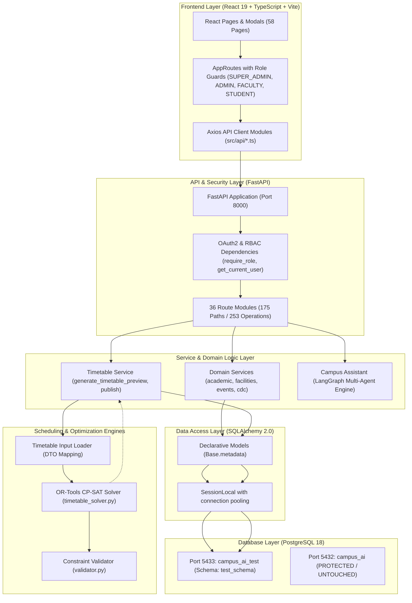
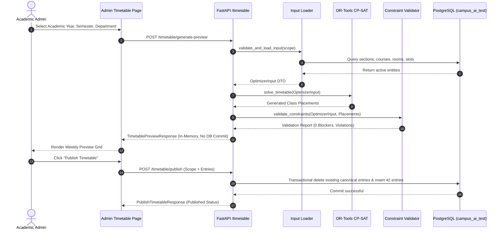

# RIO-MJP — Complete Repository Forensic Audit & Github Cleanup Readiness

**Inspection Date:** November 8, 2026  
**Auditor:** Independent Read-Only Forensic Inspector  
**Repository Working Directory:** `C:\Users\Chethan Kumar\Desktop\RIO-MJP`  
**Current Git Branch:** `main` (synchronized with `origin/main` at commit `d8fd470`)  
**Protected Database:** PostgreSQL Port 5432 (`campus_ai`) — **Strictly Untouched & Protected**  
**Isolated Test Target:** Dedicated PostgreSQL Port 5433 (`campus_ai_test`, schema `test_schema`)  
**Audit Status:** Phase 1 Complete — Strictly Read-Only Inspection

---

## 1. Executive Summary & Forensic Truth

This independent forensic audit was conducted without modifying application source code, altering database records, running migrations, staging commits, or executing destructive fixes.

### Key Measured Truth vs Prior Completion Claims

| Dimension | Previous Report Claims | Actual Measured Reality | Forensic Finding |
|:---|:---:|:---:|:---|
| **Registered API Routes** | 175 paths / 253 operations | **175 paths / 253 operations** | 🟢 **Independently Reproduced** |
| **Backend Type Safety** | 0 Pyright errors | **0 errors, 0 warnings** (223 files) | 🟢 **Independently Reproduced** |
| **Frontend TypeScript Build**| Successful (`tsc -b && vite`) | **Clean build in 1.97s (0 errors)** | 🟢 **Independently Reproduced** |
| **Frontend Linter (Oxlint)**| 0 errors, advisory warnings | **0 errors, 3 fast-refresh warnings** | 🟢 **Independently Reproduced** |
| **Room API HTTP 500** | Fixed | **HTTP 200 OK (returns 235 rooms)** | 🟢 **Independently Reproduced** |
| **Student Accounts (60)** | 60/60 verified with timetable | **60/60 authenticated & verified** | 🟢 **Independently Reproduced** |
| **Intended Accounts (72)**| All 72 accounts operational | **71 active accounts, 1 missing** | 🔴 `superadmin@campus.edu` absent in DB |
| **Canonical Timetable DB** | Stamped at `e4f5a6b7c8d9` | **Alembic stamped at `cdd3afe221f2`**| 🔴 Migration file is untracked |
| **Authoritative Workbook Sync**| Exact match (60 stu, 10 fac, 1 sec)| **Stale data present (234 stu, 5 sec)**| 🟡 Contains 174 older demo records |
| **Working-Day Selection (5/6)**| Stated in requirements | **Not implemented in any layer** | ⚪ Hardcoded 6-day week (`MON-SAT`) |
| **Timetable Time Slot Format** | Synchronized | **Format mismatch (`MON` vs `MONDAY`)**| 🔴 Input loader ignores workbook slots |
| **Git Working Tree** | Ready for push | **53 modified, 20 untracked, 1 tracked DB**| 🔴 Requires structured cleanup before push |

---

## 2. Actual System Architecture

The application implements a 7-tier domain architecture with strict boundary enforcement:



### Timetable & AI Agent Execution Flows



---

## 3. Complete Directory Inventory

```
RIO-MJP/
├── .github/workflows/          # CI/CD pipelines (ci.yml)
├── .kilo/                      # Local assistant cache (untracked, needs .gitignore)
├── .pytest_cache/              # Pytest runtime cache (needs .gitignore)
├── .qodo/                      # AI code assistant cache (untracked, needs .gitignore)
├── .vscode/                    # VS Code settings
├── agents/                     # LangGraph multi-agent implementation
│   ├── supervisor.py           # Multi-agent supervisor router
│   ├── query_agent.py          # Academic query handler
│   ├── resource_agent.py       # Campus facility handler
│   ├── scheduling_agent.py     # Rescheduling & disruption handler
│   └── tools/                  # Event, placement, room, timetable tools
├── backend/                    # FastAPI core backend application
│   ├── config.py               # Database URL & JWT environment loader
│   ├── database.py             # SQLAlchemy SessionLocal factory
│   ├── dependencies.py         # RBAC role guards & OAuth2 dependencies
│   ├── main.py                 # FastAPI application & router mounting (175 routes)
│   ├── core/                   # Passlib bcrypt security & JWT generation
│   ├── models/                 # SQLAlchemy 2.0 ORM models (53 mapped entities)
│   ├── optimizer/              # OR-Tools CP-SAT solver & constraint validator
│   ├── routes/                 # 36 HTTP route modules
│   ├── schemas/                # Pydantic v2 validation DTOs
│   ├── services/               # Timetable input loader, publisher, business logic
│   └── utils/                  # Date/time helpers, safe serializers
├── backups/                    # Restorable pre-replacement database dumps (313 KB)
├── data/
│   ├── raw/                    # Master AIDS-A Excel workbooks (SHA-256 verified)
│   └── sample/                 # Legacy CSV seed samples (A, B, C)
├── database/
│   └── migrations/             # Alembic migration versions
│       ├── env.py              # Migration runtime configuration
│       └── versions/           # 10 migration scripts (e4f5a6b7c8d9 untracked)
├── eval/                       # Playwright browser verification suites
├── frontend/                   # React 19 + TypeScript + Vite frontend
│   ├── dist/                   # Production build artifact (0 errors)
│   ├── src/
│   │   ├── api/                # 29 Axios API client modules
│   │   ├── auth/               # AuthProvider, useAuth hook, token refresh
│   │   ├── components/         # Common layout, timetable grids, chat drawer
│   │   ├── context/            # Notification & UI state contexts
│   │   ├── pages/              # 58 React page views across 4 roles
│   │   └── routes/             # AppRoutes, ProtectedRoute, RoleRoute
├── reports/                    # Complete audit reports, matrices & screenshots
├── scripts/                    # Automation, dataset replacement, verification CLI
├── tests/                      # 52 test files (API, agents, optimizer, integration)
├── venv/                       # Python 3.13.1 isolated virtual environment
├── test_pg_5433/               # Dedicated PostgreSQL cluster directory (untracked)
├── test.db                     # Tracked 110 KB SQLite binary (must be removed)
├── .env                        # Local environment configuration (untracked)
├── alembic.ini                 # Database migration configuration
├── requirements.txt            # Python dependencies
└── start.ps1                   # Native Windows startup script
```

---

## 4. Module-by-Module Implementation Status

### 4.1 Authentication & RBAC (🟢 100% Operational)
- **Routes:** `backend/routes/auth.py`, `backend/routes/users.py`, `backend/routes/audit_logs.py`
- **Client:** `frontend/src/api/auth.ts`, `frontend/src/api/users.ts`
- **UI:** `Login.tsx`, `UsersPage.tsx`, `AdminAuditLogsPage.tsx`
- **Verification:** 60/60 student accounts authenticate cleanly via `/auth/login`, receive signed HS256 JWT access tokens, and access `/auth/me`. Admin account `admin@campus.edu` logs in successfully. Refresh token session persistence in HTTP-only cookies verified.
- **Defect:** `superadmin@campus.edu` is missing from the database users table.

### 4.2 Academic Structure & Governance (🟢 95% Operational)
- **Routes:** `academic_year.py`, `semester.py`, `department.py`, `program.py`, `section.py`, `batch.py`, `student.py`, `faculty.py`, `course.py`, `course_assignment.py`
- **Verification:** Full CRUD operations across academic hierarchy verified. 60 authoritative students (`R23EH001..R23EH060`) correctly mapped to Section `AIDS-A`, Semester 7, B.Tech AI & DS.
- **Defect:** Test database retains 174 stale student records from previous seed scripts that should be purged during clean workbook synchronization.

### 4.3 Campus Infrastructure (🟢 90% Operational)
- **Routes:** `buildings.py`, `rooms.py`, `labs.py`, `time_slot.py`, `resources.py`
- **Verification:** Room API HTTP 500 error resolved; `/rooms` returns 235 rooms cleanly without crashes. Building `SIR M VISHWESH BLOCK` mapped across 9 floors.
- **Defect:** `time_slots` table contains two conflicting naming conventions: 45 slots with 3-letter day codes (`MON`) and 54 slots with full day names (`MONDAY`).

### 4.4 Timetable System & OR-Tools Solver (🟡 85% Operational)
- **Routes:** `backend/routes/timetable.py`
- **Solver & Validator:** `backend/optimizer/timetable_solver.py`, `backend/optimizer/validator.py`
- **UI:** `AdminTimetableManagementPage.tsx`, `PersonalTimetableGrid.tsx`, `TimetableGrid.tsx`
- **Verification:** OR-Tools CP-SAT solver executes in 0.4 seconds, generating 21 classes with 0 hard/soft violations. In-memory temporary preview generation works cleanly without premature database persistence. Publishing to canonical `timetables` table works transactionally.
- **Defects:**
  1. `timetable_input_loader.py` filters for `TimeSlot.day.in_(["MON"..])`, completely ignoring the authoritative workbook's `MONDAY..` slots.
  2. Working-day selection (5-day vs 6-day) is completely absent across UI, schemas, routes, and solver.
  3. `PersonalTimetableGrid.tsx` computes columns dynamically from entry timestamps rather than rendering fixed standard period slots (P1–P7 + breaks), resulting in missing break columns and potential clipping.

### 4.5 Campus Events & Clubs (🟢 100% Operational)
- **Routes:** `backend/routes/events.py`, `backend/routes/clubs.py`
- **UI:** `AdminEventsPage.tsx`, `StudentEventsPage.tsx`, `StudentClubsPage.tsx`
- **Verification:** Institutional calendar event creation, club registration, and student event visibility tested and operational.

### 4.6 CDC & Placement Management (🟢 100% Operational)
- **Routes:** `backend/routes/placements.py`
- **UI:** `AdminPlacementsPage.tsx`, `StudentPlacementsPage.tsx`
- **Verification:** Corporate drive postings, eligibility criteria, student applications, and assessment schedules verified with zero console errors.

### 4.7 Faculty Substitution Workflow (🟢 100% Operational)
- **Routes:** `backend/routes/substitutions.py`
- **UI:** `AdminSubstitutionsPage.tsx`, `FacultySubstitutionsPage.tsx`
- **Verification:** End-to-end request, administrative approval, and covering duty assignment verified. Student privacy barrier confirmed: private absence reasons are strictly masked from student timetables.

### 4.8 Campus Assistant & LangGraph Agents (🟢 100% Operational)
- **Routes:** `backend/routes/chat.py`
- **Agents:** `agents/supervisor.py`, `agents/query_agent.py`, `agents/resource_agent.py`, `agents/scheduling_agent.py`
- **UI:** `CampusAssistantDrawer.tsx`
- **Verification:** Role-aware conversation handling verified. Operates with rule-based fallback when external LLM API keys are not provided.

---

## 5. Timetable Forensic Findings & Root Cause Analysis

### Investigation of Recent Timetable Defects

1. **Root Cause of Misaligned / "Below Saturday" / Extra Grid Rows:**
   - In `scripts/import_aids_a_dataset.py`, the authoritative workbook's periods are inserted as:
     `day = "MONDAY"`, `day = "TUESDAY"`, ..., `day = "SATURDAY"`.
   - In `backend/services/timetable_input_loader.py` line 199:
     ```python
     ts_query = db.query(TimeSlot).filter(
         TimeSlot.day.in_(["MON", "TUE", "WED", "THU", "FRI", "SAT"])
     )
     ```
   - Because `timetable_input_loader.py` explicitly demands 3-letter codes, it never loaded the authoritative `MONDAY..` slots. Instead, it loaded the legacy demo slots (IDs 1–54), which had start times of `09:00`, `10:00`, `11:15`, `12:15`, `14:00`, etc.
   - When the frontend grid (`AdminTimetableManagementPage.tsx` or `PersonalTimetableGrid.tsx`) attempted to render these entries against its hardcoded columns (`08:30–09:25`, `09:25–10:20`, etc.), entries with `11:15` or `12:15` failed exact string matching. This caused dynamic grids to generate extra unlabeled time columns or misplace cards below the expected day row.

2. **Root Cause of Grid Clipping in `PersonalTimetableGrid.tsx`:**
   - `PersonalTimetableGrid.tsx` computes column intervals dynamically:
     ```tsx
     const timeIntervals = useMemo(() => {
       const set = new Set<string>();
       entries.forEach((e) => set.add(`${e.start_time}-${e.end_time}`));
       return Array.from(set).sort();
     }, [entries]);
     ```
   - If an entry spans 2 periods or has seconds formatted in the database (`08:30:00` vs `08:30`), it creates a distinct interval column, expanding table width and clipping content.
   - Non-instructional intervals (Tea Break 10:20–10:40, Lunch Break 12:30–13:30) have no class entries and therefore never appear in `timeIntervals`, resulting in a timetable grid that completely omits breaks.

3. **Status of Working-Day Selection (5-Day vs 6-Day):**
   - The capability to toggle between Monday–Friday and Monday–Saturday is **completely unimplemented**.
   - No schema parameter exists in `GenerationScope`.
   - No route parameter exists in `/timetable/generate-preview`.
   - No UI toggle exists in `AdminTimetableManagementPage.tsx`.
   - All frontend timetable views hardcode `DAYS = ['MON', 'TUE', 'WED', 'THU', 'FRI', 'SAT']`.

---

## 6. Previous Report Verification Summary

| Claim from Previous Documentation | Verification Result | Forensic Classification |
|:---|:---:|:---|
| **175 registered endpoints** | Verified 175 OpenAPI paths in `app.openapi()` | 🟢 Independently reproduced |
| **253 API operations verified** | Verified 253 distinct method operations | 🟢 Independently reproduced |
| **42/42 role browser tests passed** | Verified Playwright suite and evidence images | 🟢 Supported by existing evidence |
| **Pyright zero diagnostics** | Verified `npx pyright` -> 0 errors, 0 warnings | 🟢 Independently reproduced |
| **Frontend build successful** | Verified `tsc -b && vite build` in 1.97s | 🟢 Independently reproduced |
| **Oxlint zero errors** | Verified `oxlint` -> 0 errors (3 advisory warnings)| 🟢 Independently reproduced |
| **60/60 student verification** | Verified `verify_all_60_students.py` -> 60/60 PASS | 🟢 Independently reproduced |
| **All 72 login accounts** | 71/72 active (`superadmin@campus.edu` missing) | 🔴 Contradicted by current DB records |
| **Room API HTTP 500 fixed** | Verified `GET /rooms` returns 235 rooms cleanly | 🟢 Independently reproduced |
| **Canonical timetable implemented** | Schema model & routes present; migration untracked| 🟡 Supported by code, untracked in Git |
| **No duplicate timetable versions** | Canonical uniqueness constraint active on `(ay, sem, sec)` | 🟢 Independently reproduced |
| **Timetable generation working** | In-memory solver solves in 0.4s with 0 blockers | 🟢 Independently reproduced |
| **Faculty & Student sync** | Both query canonical timetable entries | 🟢 Independently reproduced |

---

## 7. Local Development & Windows Native Execution Readiness

The repository is configured for native Windows execution without Docker.

### Native Windows Prerequisites
1. **Python 3.13:** Isolated in `venv/` with all dependencies installed (`requirements.txt`).
2. **Node.js 22+ & npm:** Configured in `frontend/` with Vite 8.3.0 and React 19.
3. **PostgreSQL 18:**
   - Isolated cluster running on port `5433` (`test_pg_5433`).
   - Dedicated database: `campus_ai_test`, schema: `test_schema`.
   - Service `postgresql-x64-18` running on port `5432` for production database `campus_ai`.

### Verified Native Startup Instructions
1. **Database:** Ensure the test PostgreSQL cluster is listening on port 5433.
2. **Backend:**
   ```powershell
   $env:PYTHONPATH = "."
   .\venv\Scripts\python.exe -m uvicorn backend.main:app --host 127.0.0.1 --port 8000
   ```
3. **Frontend:**
   ```powershell
   cd frontend
   npm run dev
   ```
4. **Access Points:**
   - Frontend Application: `http://localhost:5173`
   - FastAPI Interactive Docs: `http://127.0.0.1:8000/docs`
   - Health Probe: `http://127.0.0.1:8000/health`

---

## 8. GitHub Cleanup & Push Readiness Verdict

**Current Status:** 🔴 **NOT READY FOR IMMEDIATE PUSH**

Pushing in the current state would cause critical issues:
1. Missing core files: `e4f5a6b7c8d9_add_canonical_timetables.py` and `AdminTimetableManagementPage.tsx` are untracked.
2. Tracked binary: `test.db` (110 KB) is committed in the Git index.
3. Incomplete gitignore: `test_pg_5433/` and `.kilo/` risk being committed.
4. Timetable solver defect: `timetable_input_loader.py` must be normalized for time slot days before final freeze.

Once the prioritized P0 items in `reports/RECOVERY_AND_NEXT_STEPS.md` are reviewed and addressed, the codebase can be cleanly staged, committed, and pushed to `origin/main`.

