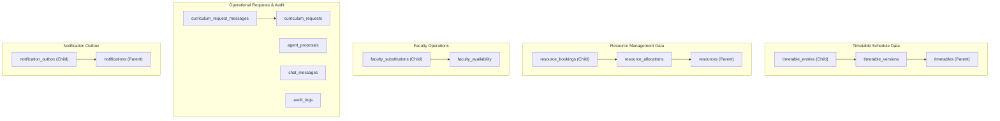

# RIO-MJP — Settings & Safe Operational Data Management Report

**Date:** November 9, 2026  
**Status:** IMPLEMENTED, MIGRATED & FULLY VERIFIED  
**Target Environment:** Local PostgreSQL 18 (Port 5433 / `campus_ai_test`), Head Revision `f1a2b3c4d5e6`  

---

## 1. Subsystem Architecture Overview

The Settings and Safe Operational Data Management subsystem provides a database-backed, RBAC-protected administrative control plane for configuring institutional parameters and managing ephemeral, generated operational data without compromising academic master data.

### Five Architectural Settings Domains

| Domain | Scope & Functionality | Persistence Mechanism | Security / Boundary Policy |
|---|---|---|---|
| **1. General Settings** | Institution name, campus name, academic department name, timezone (`Asia/Kolkata`), notification broadcast toggles (timetable publish, substitution alerts). | `system_settings` table (key-value JSON storage) | Accessible to ADMIN and SUPER_ADMIN. Validated via Pydantic schemas. |
| **2. Data Management** | Live operational category counts, dry-run dependency previews, controlled topological deletion for generated schedules, bookings, and request logs. | Topological transactional deletes against PostgreSQL | Strict master safeguard: Master academic entities and accounts are structurally protected. |
| **3. Timetable Settings** | Default working days (`MON_SAT` or `MON_FRI`), max consecutive faculty lecture limits, soft lab preference weighting. | `system_settings` table (`timetable.settings`) | Applied as constraints in the OR-Tools CP-SAT timetable generation engine. |
| **4. User & Access Settings** | JWT session lifetimes (Access: 20m, Refresh: 7d), role-based privilege overview, account provisioning status (72 accounts). | Server-side environment & configuration display | Non-editable secrets policy: Secret keys and passwords remain server-side environment variables. |
| **5. System & Integrations** | Real-time connectivity telemetry for PostgreSQL database, Multi-Agent AI system status, and Supabase integration status. | Live connection ping & environment evaluation | Read-only infrastructure status reporting. |

---

## 2. Database Schema & Alembic Migration

### Model Specification (`backend/models/system_setting.py`)
```python
class SystemSetting(Base):
    __tablename__ = "system_settings"

    id: Mapped[int] = mapped_column(Integer, primary_key=True, autoincrement=True)
    category: Mapped[str] = mapped_column(String(50), nullable=False, index=True)
    key: Mapped[str] = mapped_column(String(100), nullable=False, unique=True, index=True)
    value_json: Mapped[str] = mapped_column(Text, nullable=False)
    description: Mapped[Optional[str]] = mapped_column(String(255), nullable=True)
    updated_by_user_id: Mapped[Optional[int]] = mapped_column(Integer, ForeignKey("users.id"), nullable=True)
    created_at: Mapped[datetime.datetime] = mapped_column(DateTime, default=datetime.datetime.utcnow)
    updated_at: Mapped[datetime.datetime] = mapped_column(DateTime, default=datetime.datetime.utcnow, onupdate=datetime.datetime.utcnow)
```

### Migration History
- **Revision ID:** `f1a2b3c4d5e6`
- **Revises:** `e4f5a6b7c8d9` (canonical timetable tables)
- **File:** `database/migrations/versions/f1a2b3c4d5e6_add_system_settings_table.py`
- **Applied Status:** Head revision applied to `campus_ai_test` and `campus_ai_pytest`.

---

## 3. Safe Operational Data Management Engine

### Strict Master Data Safeguards
The operational data management engine guarantees that clearing generated operations will **NEVER** drop, truncate, or delete master entities:
- **Protected Accounts:** 72 total accounts (1 Super Admin, 1 Admin, 10 Faculty, 60 Students).
- **Protected Master Academic Structures:** Departments (`AI & DS`), Programs (`B.Tech AI & DS`), Academic Years (`2026-2027`), Semesters (`Semester 7`), Sections (`AIDS-A`), Batches (`2023`).
- **Protected Facilities:** 1 Building (`SIR M VISHWESH BLOCK`), 9 Floors (Ground Floor to 8th Floor), 225 Rooms, 18 Laboratories.
- **Protected Curriculum:** 18 Authoritative Courses / Subjects and their course codes.
- **Protected Time Definitions:** 9 standard periods per day (08:30 to 16:15) including Tea Break and Lunch Break.

### Safe Topological Deletion Ordering
When clearing operational data, deletions execute within a strict, atomic database transaction in child-to-parent foreign key order:



### Safety Features
1. **Dry-Run Preview (`POST /admin/data-management/preview`):** Evaluates selected categories and returns exact counts, table breakdown, and foreign key dependencies without touching the database.
2. **Explicit Confirmation Gating:** Requires client-side checkbox acknowledgement and confirmation token before `POST /admin/data-management/clear` executes.
3. **Audit Logging:** Every preview and clear operation writes an immutable `AuditLog` entry detailing the acting administrator, affected tables, and deleted record count.

---

## 4. API Endpoints Inventory

| Method | Endpoint | Authorization | Description |
|---|---|---|---|
| `GET` | `/admin/settings` | ADMIN, SUPER_ADMIN | Retrieve combined institutional, timetable, access, and system settings. |
| `PUT` | `/admin/settings/general` | ADMIN, SUPER_ADMIN | Update institutional details and notification preferences. |
| `PUT` | `/admin/settings/timetable` | ADMIN, SUPER_ADMIN | Update default working days and consecutive lecture limits. |
| `GET` | `/admin/data-management/summary` | ADMIN, SUPER_ADMIN | Retrieve live table record counts categorized by operational domain. |
| `POST` | `/admin/data-management/preview` | ADMIN, SUPER_ADMIN | Dry-run preview showing exact tables and records affected. |
| `POST` | `/admin/data-management/clear` | ADMIN, SUPER_ADMIN | Atomically purge selected generated operational categories with rollback protection. |
| `GET` | `/admin/system/status` | ADMIN, SUPER_ADMIN | Real-time database, agent readiness, and Supabase integration status. |

---

## 5. Automated Verification Results

### Unit & Integration Test Suite (`tests/api/test_admin_settings_and_data_management.py`)
- `test_get_settings_unauthorized_rejected`: **PASSED** (HTTP 401 on missing token).
- `test_get_settings_student_role_forbidden`: **PASSED** (HTTP 403 on student access).
- `test_get_and_update_general_settings`: **PASSED** (Admin successfully updates institution and alert toggles).
- `test_get_and_update_timetable_settings`: **PASSED** (Admin updates working days to `MON_SAT` and lecture limits).
- `test_data_management_summary`: **PASSED** (Summary reflects exact table counts across 5 operational categories).
- `test_data_clear_preview_and_safe_execution`: **PASSED** (Dry-run preview matches clear count; master tables verify 100% untouched).

### Live Playwright Browser Verification
- Navigated to `/admin/settings` as Admin.
- Verified tab switching across General Settings, Data Management, and System & Integrations.
- Verified live table counts in Data Management tab.
- Clicked "CLEAR ALL GENERATED OPERATIONAL DATA" and confirmed modal opens with "Confirm Operational Data Purge".
- Confirmed modal cancellation and closed modal safely.
- Verified System & Integrations tab displaying `PostgreSQL Database: CONNECTED` on host `127.0.0.1`, port `5433`, schema `test_schema`.
- Saved artifact screenshot: `reports/screenshots/05_admin_settings.png`.

